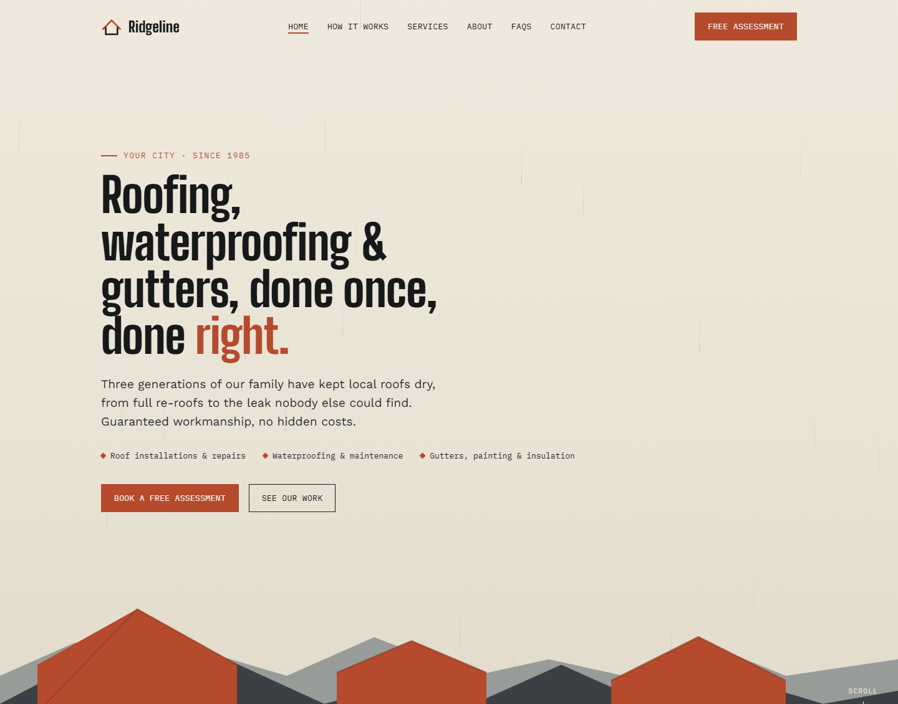
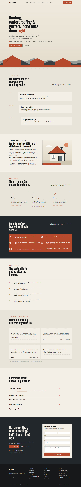
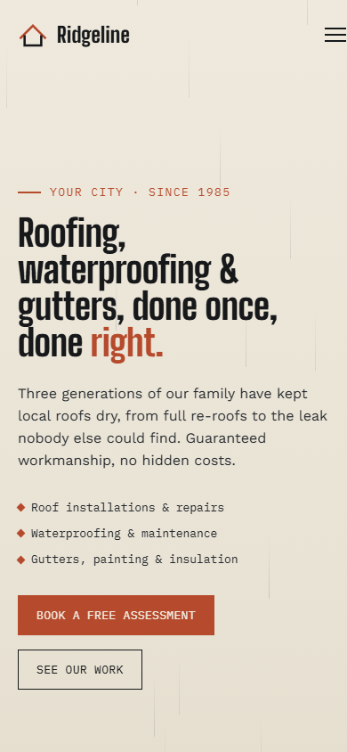

# Generic Roofing Company Website

A reusable, fully working one-page website template for a roofing, waterproofing and gutters contractor. The demo brand is **Ridgeline Roofing**, with placeholder contact details and sample content that you can swap for your own.

It is a single self-contained file, `index.html`, with no build step. The only external resource is Google Fonts.

Open `index.html` in any browser to view it.

## Preview

### Desktop

Full desktop page

### Mobile

Full mobile page

## What was improved

**Made generic**
- All real business details were replaced with placeholders: company name, family names, address, phone number, email, hotlinked photo, testimonials and links to another company's website.
- The family photo is now an inline SVG illustration, so there are no external images to break.

**Everything works**
- Mobile menu rewritten. The original menu was positioned relative to the blurred header once you scrolled, so it never covered the screen. It now covers the viewport, closes on link click or `Esc`, locks page scroll and updates `aria-expanded`.
- New **quote request form** with validation, inline errors and a success message (demo only, nothing is sent). The service cards and footer links pre-select the matching service in the form.
- Service card and footer links that pointed to another site now go to the quote form.
- The corrugated divider under the hero was invisible (same colour as the background). It now renders properly.
- The hero text no longer collides with the skyline illustration, and the services grid no longer touches the screen edges on tablets.
- Active section highlighting in the nav, back to top button, phone and email `tel:` and `mailto:` links, and a map link for the address.

**Quality**
- Skip link, focus styles, ARIA labels, decorative SVGs hidden from screen readers and `prefers-reduced-motion` support.
- All em dashes and en dashes removed from the copy and title.

## Customising

Search `index.html` for these placeholders and replace them:

| Placeholder | Where |
| --- | --- |
| `Ridgeline` / `Ridgeline Roofing` | Header, footer, titles |
| `Your City`, `Your Suburb`, `123 Example Street` | Hero, footer |
| `011 000 0000` / `0110000000` | Call button, footer |
| `hello@example.com` | Contact button, footer |
| `1985` and the generation labels | Hero, About, Trust band, FAQs |
| Testimonials | Reviews section (marked as samples) |
| Social links | Footer (currently platform home pages) |

To receive form submissions, point the form at a service such as a form backend or your own endpoint. It currently shows a demo confirmation only.
